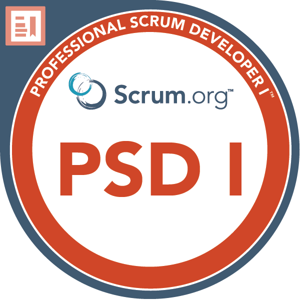

### Hi there 👋

<!--
**SmotrovaLilit/SmotrovaLilit** is a ✨ _special_ ✨ repository because its `README.md` (this file) appears on your GitHub profile.

Here are some ideas to get you started:

- 🔭 I’m currently working on ...
- 🌱 I’m currently learning ...
- 👯 I’m looking to collaborate on ...
- 🤔 I’m looking for help with ...
- 💬 Ask me about ...
- 📫 How to reach me: ...
- 😄 Pronouns: ...
- ⚡ Fun fact: ...
-->

I'm a Software Engineer with 10 years of industry experience, spending the last 3.5 years specializing in the development of secure enterprise systems.

💡 I'm passionate about problem-solving, troubleshooting, exploring novel technologies, and taking on new challenges.

📫 How to reach me: [smotrovalilit@gmail.com](mailto:smotrovalilit@gmail.com) or linkendin https://www.linkedin.com/in/smotrovalilit/

## Certifications

## Code Examples
 | [DDD, CQRS ](https://github.com/SmotrovaLilit/accounts) | 
 [AI Integration ](https://github.com/SmotrovaLilit/voiceassistant) | 
  [Tic Tac Toe](https://github.com/SmotrovaLilit/tictactoe) | 
  [Algorithms](https://github.com/SmotrovaLilit/kata) |
  [Go samples](https://github.com/SmotrovaLilit/go-samples) |
  [UI ](https://github.com/SmotrovaLilit/blot) | 

## Hobbies

I enjoy dancing 💃, crocheting 🧶, doing satin stitch embroidery 🪡, and sewing clothes 👗. I also play Elden Ring🎮 and Path of Exile 2 🛋️.

